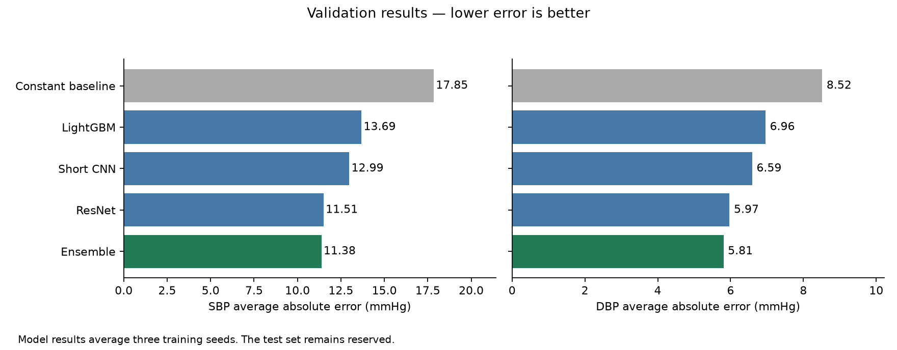
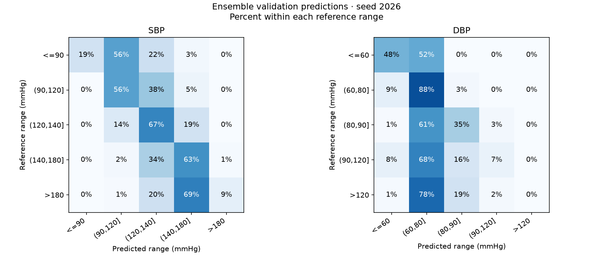

# CufflessAI: An Educational Blood Pressure Estimation

**[Open the live demo](https://microsoft-1d-blood-pressure-estimation.streamlit.app/)** — Run live blood pressure prediction on bundled PPG examples. Educational prototype.

### 👥 **Team Members**

| Name             | GitHub Handle | Contribution                                                             |
|------------------|---------------|--------------------------------------------------------------------------|
| Kushagra Dhall    | @KR-0000 | EDA, data setup, model comparisons, ensembles and evaluation |
| Ingrid Escalante-Hernandez   | @imehtn     | Data collection, exploratory data analysis (EDA), dataset documentation  |
| Katherine Wu     | @wukatherine  | EDA, Data visualization                 |
| Joanna Liu      | @lte24       | Missing values  |
| Sarah To       | @aizhenii    | Outliers           |
| Kien Nguyen       | @tkien17    |   EDA         |
| Harshitha Venkateswaran       | @harshithavenkateswaran-code    |       feature engineering     |
| Tanzina Sumona       | @TanzinaS    |       developing 1D CNN model using raw PPG data     |

## 🎯 **Project Highlights**

We estimate systolic and diastolic blood pressure from five-second PPG signals. Our selected ensemble achieved validation mean absolute errors of 11.38 mmHg for SBP and 5.81 mmHg for DBP.

For installation, downloads, prediction and training, use [SETUP.md](SETUP.md). The [walkthrough notebook](notebooks/project_walkthrough.ipynb) presents the workflow with saved results and runnable examples.

For a minimal web interface that runs live CPU prediction on bundled PPG examples, see the [Streamlit demo](demo/README.md).

## 🏗️ **Project Overview**

This Microsoft challenge is part of Break Through Tech AI Studio. We explore whether optical pulse signals can estimate blood pressure using the public UCI dataset, comparing waveform models with models built from extracted PPG features.

## 📊 **Data Exploration**

### Dataset(s) used

The project uses the **UCI Cuff-Less Blood Pressure Estimation dataset**, distributed as four MATLAB files: `Part_1.mat` through `Part_4.mat`. Although the project calls these files “raw,” UCI describes the source dataset as preprocessed.
- **Format:** MATLAB v7.3 files, read as HDF5 using `h5py`. The project also creates a local processed archive, `processed_dataset.npz`.
- **Size:** 12,000 records, each containing synchronized signals with variable lengths of 1,000–74,000 samples. The three channels are sampled at **125 Hz**:
  - **PPG:** optical pulse waveform; intended model input.
  - **ABP:** arterial blood-pressure waveform in mmHg; source of reference SBP/DBP labels.
  - **ECG:** electrocardiogram; retained for possible future work, but outside the initial model scope.
- **Processed dataset:** 528,828 complete, non-overlapping five-second windows, each 625 samples long, with aligned PPG, ABP, and ECG arrays. That is 330,517,500 retained samples per channel, or about 734.5 hours of signal.

### Data exploration and preprocessing

The data was inspected record by record to check record shapes, channel alignment, sample lengths, and invalid values. The loader reads the three synchronized channels, divides each record into complete 625-sample windows, and drops any remaining samples shorter than a full window rather than padding them. It saves the aligned windows to `processed_dataset.npz`.

During initial exploration, SBP and DBP were derived from the **maximum and minimum ABP sample in each five-second window**, respectively. ECG remains in the processed archive, but the modeling task uses PPG to predict the ABP-derived labels.

The EDA also checked PPG/ABP numeric validity, counted numeric zeros in PPG, searched for exact repeated recordings, and compared whole-window ABP extrema with exploratory beat-level extrema. 

### EDA insights

- All 12,000 records had the expected three-channel structure, and channels were aligned.
- Record lengths varied substantially. Windowing produced **528,828 complete windows**; 10,082 records had a short trailing segment discarded. In total, 3,172,500 sample positions per channel were dropped—about 7.05 hours across the dataset.
- PPG and ABP had no observed NaN or infinite samples. ECG had 16 NaN values in one record.
- **5,407 PPG windows (1.02%)** contained at least one numeric zero. The EDA did not establish whether these zeros indicate artifacts or valid signal values.
- The audit identified **14 exact duplicate recordings**, including 13 matches across different part files. The later duplicate copies account for 700 windows. This creates a risk of train/test leakage if matching records or neighboring windows are split independently.
- The median of the baseline whole-window labels was **131.10 mmHg for SBP** and **62.03 mmHg for DBP**. In a sample of 20,263 windows, whole-window maxima were a median 2.35 mmHg above detected beat-peak medians, while minima were 1.76 mmHg below detected beat-trough medians. These comparisons are exploratory, not clinical validation.
- The processed PPG and ABP arrays matched windows reconstructed from the source files exactly and in order. This verifies loading consistency, not signal quality.

### Challenges and assumptions

Recordings do not provide verified patient identities. Known exact duplicates are excluded, and windows from a recording stay together in the split. Numeric zeros alone do not establish signal quality. The final pipeline derives reference pressures from the medians of complete ABP beats rather than the original whole-window extrema.

### Visualizations 

Plots showing SBP nearest global median, Highest global SBP, Lowest global DBP, Smallest global PPG range

View of what zero-value runs look like in the data

---

## 🧠 **Model Development**

The recommended ensemble combines 80% multi-task ResNet, 13% short CNN and 7% LightGBM using sixteen PPG features. The waveform models learn from pulse shape, while LightGBM uses extracted features. Their predictions are combined using fixed weights selected within training.

## 📈 **Results & Key Findings**

| Model | SBP MAE | DBP MAE | SBP RMSE | DBP RMSE |
|---|---:|---:|---:|---:|
| Training median | 17.85 | 8.52 | 21.98 | 11.48 |
| LightGBM, sixteen PPG features | 13.69 | 6.96 | 18.12 | 9.87 |
| Short CNN | 12.99 | 6.59 | 17.21 | 9.49 |
| Kernel-seven ResNet, L1 | 11.51 | 5.97 | 15.85 | 9.10 |
| **Recommended ensemble** | **11.38** | **5.81** | **15.57** | **8.87** |

Errors are in mmHg on 75,601 validation windows from 1,769 recordings. Model rows average three seed-specific metrics, not predictions across seeds. The test set remains reserved.

## 🚀 **Limitations and Next Steps**

Errors remain larger at pressure extremes. Recording-based splits cannot establish performance on unseen patients because patient identities are unavailable. Validation informed development; the test set remains reserved. Next steps include evaluating that reserved set and testing generalization to another dataset or device.

## 📝 **License**

A project license has not yet been selected.

## 📄 **References**

- [UCI Cuff-Less Blood Pressure Estimation dataset](https://archive.ics.uci.edu/dataset/340/cuff%2Bless%2Bblood%2Bpressure%2Bestimation)
- [Challenge project overview](Challenge-Project-Overview.md)

## 🙏 **Acknowledgements**

Thank you to our Challenge Advisors Fatima Rafiqui and Wee Hyong Tok, our coach Anshul Rehpande, Microsoft representatives, our TA, and everyone who supported our project.
