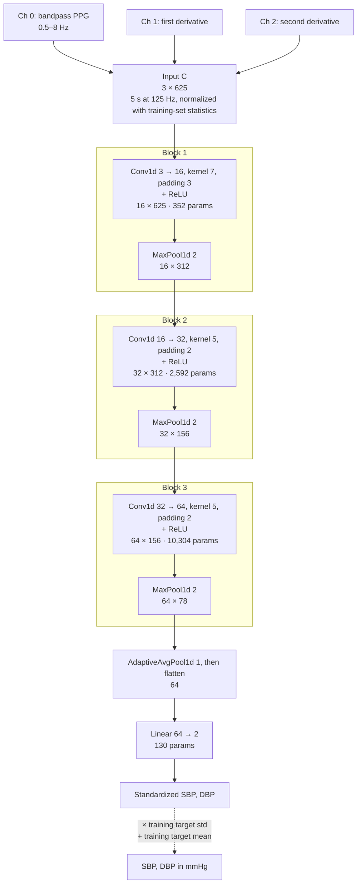
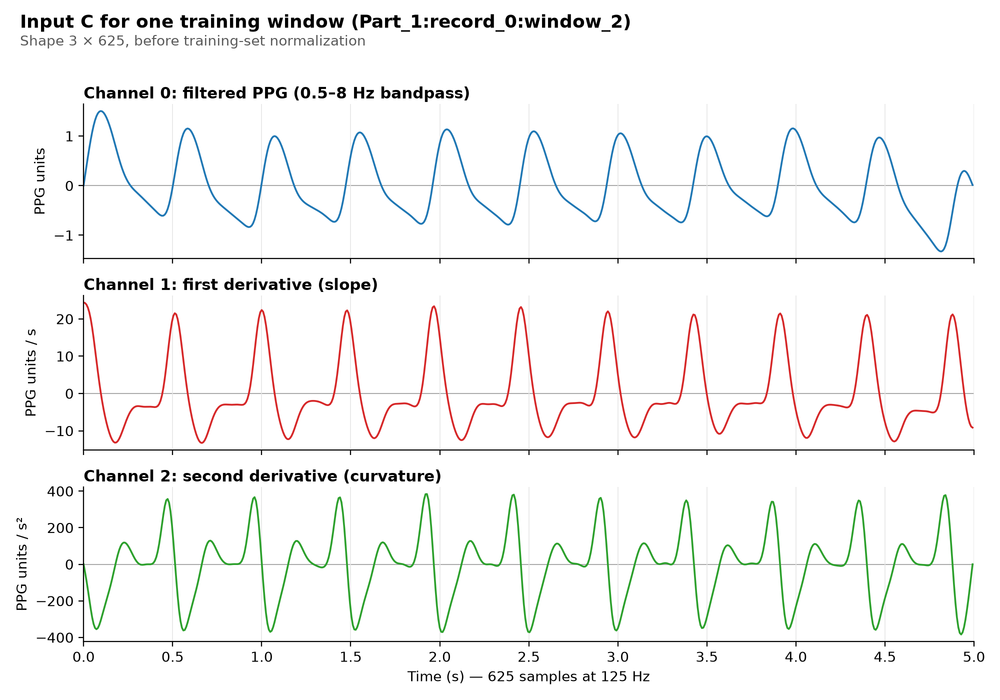
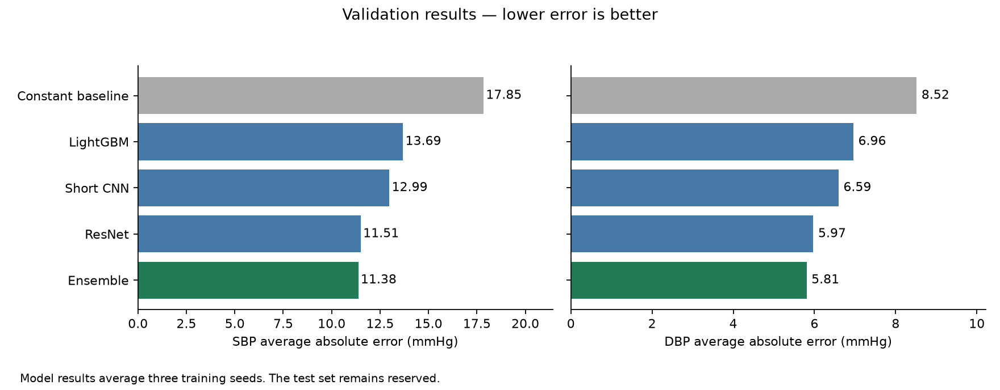

# 1D CNN for blood pressure from PPG

> **Verified 2026-11-08** against `main` at commit `7082edf` (after PR #46 and PR #48 merged on 2026-11-05). The CNN code, configuration and saved metrics described here are unchanged since PR #46's final commit `dc038fd`, which this document was first checked against on 2026-11-04.
> Numbers come from `reports/final/cnn_metrics.csv` and `reports/final/selected_metrics.csv`; settings come from `configs/selected_models.json`. Nothing here is clinically validated.

## Contents

1. [Summary](#1-summary)
2. [Who built what](#2-who-built-what)
3. [Architecture](#3-architecture)
4. [From raw PPG to mmHg](#4-from-raw-ppg-to-mmhg)
5. [Training](#5-training)
6. [Results (validation only)](#6-results-validation-only)
7. [How to use it](#7-how-to-use-it)
8. [Tests](#8-tests)
9. [Limitations](#9-limitations)
10. [Troubleshooting](#10-troubleshooting)
11. [FAQ](#11-faq)
12. [Open questions and planned figures](#12-open-questions-and-planned-figures)

## 1. Summary

The CNN reads one five-second PPG window (625 samples at 125 Hz) and predicts two numbers: systolic (SBP) and diastolic (DBP) blood pressure in mmHg. It learns pulse-shape patterns directly from the waveform instead of from hand-made features.

There are two versions:

| Version | Where | Status |
|---|---|---|
| **Original prototype** | PR #39, merged 2026-10-28 (`models/cnn_model.py`, `models/train_cnn.py`) | Small proof of concept, trained on 300 recordings for 3 epochs |
| **`cnn_c`** | PR #46, merged 2026-11-05 | Same network design, with three input channels and full-scale training. It is **13% of the team's recommended ensemble.** |

On validation data, `cnn_c` reaches **12.99 mmHg SBP / 6.59 mmHg DBP mean absolute error**, against 17.85 / 8.52 for always predicting the training median. It is not the strongest single model: the ResNet scores 11.51 / 5.97.

## 2. Who built what

| Part | Author |
|---|---|
| `PPGCNN` design: three conv blocks (16/32/64 filters, kernels 7/5/5), max pooling, global average, linear head | Tanzina, PR #39 |
| `models/train_cnn.py` prototype: recording sampling, train/validation-only loading, leakage guards, per-window z-score, L1/Adam training loop | Tanzina, PR #39 |
| `tests/test_cnn_model.py` (output shape, loader guards) | Tanzina, PR #39 |
| Complete-beat SBP/DBP label method in `data/bp_utils.py`, used for all PR #46 labels (the module was first added by Kien for peak/valley labels) | Tanzina, PR #41; refactored by Kushagra in PR #46 |
| Configurable `PPGCNN(input_channels, channels, dilations)` with input checks | Kushagra, PR #46 |
| "Input C" three-channel preprocessing, training-set normalization, `fit_wave` training loop, chosen settings and epoch counts, three seeds | Kushagra, PR #46 |
| `ResidualPPGCNN` (the ResNet), `build_wave_model`, ensemble weights, saved model bundle, `cnn_metrics.csv` | Kushagra, PR #46 |

`models/train_cnn.py` and `tests/test_cnn_model.py` are unchanged in PR #46.

## 3. Architecture

`PPGCNN` in `models/cnn_model.py`. The diagram shows `cnn_c` as configured in `configs/selected_models.json`. Shapes are channels × samples for one window; batch size is omitted.



*Total: 13,378 trainable parameters. The original prototype (PR #39) is the same network with one input channel (Conv1d 1 → 16, 128 parameters in the first layer, 13,154 in total). The dashed step is done by `predict_array`, outside the network.*

The table gives the same layers for either version; `C` is the number of input channels (1 in the original, 3 in `cnn_c`).

| # | Layer | Output shape | Purpose |
|---|---|---|---|
| 1 | Conv1d C→16, kernel 7, padding 3, ReLU | 16 × 625 | Short local shapes (about 56 ms), such as a steep upstroke |
| 2 | MaxPool1d(2) | 16 × 312 | Halve the length and keep the strongest response |
| 3 | Conv1d 16→32, kernel 5, padding 2, ReLU | 32 × 312 | Combine shapes into larger patterns |
| 4 | MaxPool1d(2) | 32 × 156 | |
| 5 | Conv1d 32→64, kernel 5, padding 2, ReLU | 64 × 156 | Larger, pulse-scale patterns |
| 6 | MaxPool1d(2) | 64 × 78 | |
| 7 | AdaptiveAvgPool1d(1) | 64 × 1 | Average each filter over the window, so position doesn't matter |
| 8 | Linear 64→2 | 2 | Standardized [SBP, DBP] |

- **Parameters:** 13,154 in the original (1 channel) and 13,378 in `cnn_c` (3 channels). The extra 224 are the first layer's weights for the two new channels (2 × 16 × 7). Both counts were checked by building the models.
- **What each output position sees:** about 38 input samples (≈0.3 s), less than one heartbeat at typical heart rates. The global average then summarizes the whole window.
- No dropout or BatchNorm.
- PR #46 adds optional dilations, but `cnn_c` uses the default (1, 1, 1), so its layers match the original apart from the input channels.

**How it differs from the ResNet (`ResidualPPGCNN`, PR #46):**

| | `cnn_c` | Multi-task ResNet |
|---|---|---|
| Blocks | 3 plain conv blocks | Stride-2 stem conv, then 3 residual blocks of 2 convs each, with shortcut connections |
| Downsampling | Max pooling | Strided convolutions |
| Normalization layers | None | BatchNorm |
| Kernels | 7, 5, 5 | 7 (selected configuration) |
| Loss | MSE (standardized) | L1 (standardized) plus 0.2 × the mean of the SBP and DBP cross-entropies (five pressure ranges each) |
| Parameters | 13,378 | 61,692 |

## 4. From raw PPG to mmHg

### Original prototype (PR #39)

1. Input is `data/cleaned_dataset.npz` from the PR #40 cleaning notebook: NeuroKit-cleaned PPG plus SBP/DBP **means of detected peaks and valleys**. Those are the older labels that PR #41 later replaced.
2. Windows with non-finite values, or with SBP ≤ DBP, are dropped (`valid_mask`).
3. Each window is z-scored with its own mean and standard deviation, which uses no shared statistics.
4. Shape `(N, 1, 625)` goes into the CNN.
5. Outputs are multiplied by the training-label standard deviation, then the training-label mean is added, giving mmHg.

### `cnn_c` (PR #46)

**Labels** come from ABP, which is used for training only:
- ABP is low-pass filtered at 40 Hz (order 4).
- SBP and DBP are the **median over complete heartbeats** using the PR #41 method (label version `pr41_complete_beats_median_v2`).
- A window is used only if all of these hold:
  - PPG and ABP are both finite, not flat, and at most 5% zeros;
  - ABP has no repeated flat maxima (saturation);
  - NeuroKit PPG processing succeeds;
  - there are at least 2 complete beats, and SBP > DBP;
  - SBP is between 60 and 250 mmHg, and DBP is between 30 and 150.

All of this is in `configs/pipeline.json`.

**Input C** is built from the source PPG, not the NeuroKit-cleaned signal, in `models/preprocessing_inputs.py` and `models/selected_inputs.py`:

1. Fill zero samples by interpolating between neighbouring samples.
2. Pad 250 samples on each side by odd reflection, to reduce filter edge effects.
3. Apply a 0.5–8 Hz Butterworth bandpass (order 2, zero-phase `sosfiltfilt`), then trim back to 625 samples.
4. Build three channels:

| Channel | Content | Calculation |
|---|---|---|
| 0 | Bandpass-filtered PPG | Step 3 |
| 1 | First derivative (slope) | Savitzky–Golay, window 11, cubic, `delta = 1/125` |
| 2 | Second derivative (curvature) | Same filter, `deriv = 2` |

The first and last 5 samples of channels 1–2 come from derivatives of the padded, filtered signal, which reduces edge artifacts.



*One training-split window (`Part_1:record_0:window_2`; reference labels 125.8 / 69.8 mmHg from 9 complete ABP beats). The channels were produced by `models.selected_inputs.input_c`, the function used at prediction time, from the source PPG. Each heartbeat appears as a peak in channel 0, a sharp positive slope peak in channel 1 during the upstroke, and a positive-then-negative curvature pair in channel 2. Values are shown before training-set normalization; `cnn_c` receives each channel shifted and scaled by fixed training-set constants, which changes the units but not the shape.*

How the window was chosen: the first training window, in the split loader's record order, that passes PR #46's cleaning (`cleaning.pipeline.clean_window`) with SBP 125–140 mmHg, DBP 55–70 mmHg and at least 4 complete beats. Its recording is one of the reviewed EDA examples that `configs/split.json` forces into training.

To regenerate the figure, run this from the repository root. It needs `data/processed_dataset.npz` and `data/raw/Part_1.mat`, and reads no validation or test waveforms:

```bash
python models/figures/make_cnn_input_channels.py
```

**Normalization:** each channel is centred and scaled using its mean and standard deviation over the **training set** (`fit_waveform_scaler`). Targets are standardized the same way, using training labels only.

**Output:** `predict_array` multiplies the network output by the training target scale and adds the training target mean, giving SBP and DBP in mmHg.

**In the ensemble:** `0.80 × ResNet + 0.13 × cnn_c + 0.07 × LightGBM`, combined in mmHg (`SelectedPredictor._predict`).

## 5. Training

### Data splits

Recordings are assigned about 70/15/15 to train/validation/test (seed 2026, `configs/split.json`). All windows from one recording stay in one split, and 14 exact duplicate recordings are excluded. This separates **recordings, not patients**, because patient IDs are unavailable. Neither version trains or evaluates on the test split.

### Settings

| | Original prototype | `cnn_c` |
|---|---|---|
| Training data | 300 random train recordings | Full train split: 363,965 windows, 8,273 recordings |
| Evaluation data | 100 random validation recordings | Full validation split: 75,601 windows, 1,769 recordings |
| Loss | L1 on standardized targets | MSE on standardized targets (`cnn_c` sets no `loss`, so `fit_wave` uses `nn.MSELoss`) |
| Optimizer | Adam, learning rate 1e-3 | AdamW, learning rate 1e-3, weight decay 1e-4 |
| Batch size | 128 | 256 |
| Epochs | 3 (default) | Fixed per seed: 48 (2026), 53 (2027), 63 (2028) |
| Seeds | 2026 | 2026, 2027, 2028; results are averaged across them |
| Determinism | `torch.use_deterministic_algorithms(True)` | Same, plus seeded shuffling and 2 CPU threads |
| Saved model | Not saved | `components/cnn_c/seed_<seed>/model.pt` (weights, parameters, preprocessing, seed, epochs), with SHA-256 checks in `manifest.json` |

### How settings were chosen

`configs/selected_models.json` says: *"Frozen inner-selected configurations and fixed per-seed full-training durations; no original-validation reselection."* According to this description, settings and epoch counts were chosen on held-out parts of the **training** data (inner splits), then the final models were trained on the full training split for the recorded number of epochs.

⚠️ The code that ran this selection, and how the ensemble weights were chosen, are not in the repository (see [Open questions](#12-open-questions-and-planned-figures)).

## 6. Results (validation only)

**All results below are validation results.** No CNN has been evaluated on the reserved test split. All values are MAE or RMSE in mmHg, lower is better.

### PR #46, recorded

75,601 validation windows from 1,769 recordings. Each row is the mean of three seed-specific metrics.

| Model | SBP MAE | DBP MAE | SBP RMSE | DBP RMSE |
|---|---:|---:|---:|---:|
| Training median (constant) | 17.85 | 8.52 | 21.98 | 11.48 |
| Training mean (constant) | 17.97 | 8.69 | 21.99 | 11.21 |
| LightGBM, 16 features | 13.69 | 6.96 | 18.12 | 9.87 |
| **`cnn_c`** | **12.99** | **6.59** | **17.21** | **9.49** |
| ResNet, L1 | 11.51 | 5.97 | 15.85 | 9.10 |
| Recommended ensemble | 11.38 | 5.81 | 15.57 | 8.86* |

\*The README rounds this to 8.87.



### More about `cnn_c`

| | SBP MAE | DBP MAE |
|---|---:|---:|
| Train, 3-seed mean | 11.24 | 5.52 |
| Validation, seed 2026 / 2027 / 2028 | 13.08 / 12.89 / 12.99 | 6.54 / 6.69 / 6.55 |
| Validation, each recording weighted equally | 13.43 | 6.99 |
| Validation mean bias (predicted − true) | +1.43 | −0.17 |

The train/validation gap is small (about 1.8 mmHg SBP), and results are stable across seeds.

### Errors by pressure range (indicative only)

`reports/final/pressure_summary.csv` holds validation errors by pressure range for a model labelled `previous_cnn_C`. The file doesn't record which seed it is, or whether it is exactly the final `cnn_c`, so treat these numbers as indicative:

| SBP range | MAE | Bias | DBP range | MAE | Bias |
|---|---:|---:|---|---:|---:|
| ≤ 90 | 24.76 | +23.74 | ≤ 60 | 6.52 | +5.95 |
| (120, 140] | 8.22 | +0.73 | (60, 80] | 4.84 | −0.80 |
| > 180 | 34.02 | −33.78 | > 120 | 58.11 | −58.11 |

The model pulls predictions toward the middle: it overestimates low pressures and underestimates high ones.

### Original prototype

PR #39 reports that it trained on 300 recordings and validated on 100 for 3 epochs, and **did not outperform the training-mean baseline**. The exact numbers were not recorded, and those runs used the older labels.

## 7. How to use it

### Original prototype (PR #39, `models/train_cnn.py`)

```bash
python -m models.train_cnn
python -m models.train_cnn --train-records 300 --validation-records 100 --epochs 3 \
    --batch-size 128 --learning-rate 1e-3 --seed 2026 --data data/cleaned_dataset.npz
```

- These are the defaults (checked with `--help`). The script prints validation MAE/RMSE for the CNN and the training-mean baseline, and saves nothing.
- **Limitation:** `data/cleaned_dataset.npz` from the old PR #40 notebook has the old labels. The script's docstring and error message still describe that notebook, which PR #46 moves to `cleaning/archive/clean_data.ipynb`.
- PR #46's prepared archive (`data/derived/prepared/cleaned_dataset.npz`) contains the arrays the script needs (`ppg`, `sbp`, `dbp`, `window_ids`, `source_record_ids`, `split_assignments`), so `--data` could point there. That combination has not been run.

### `cnn_c` inside the ensemble (PR #46)

Setup, data preparation and the bundle download are in [`SETUP.md`](../SETUP.md). Once the `selected-v1` bundle is extracted to `artifacts/selected-v1/`:

```bash
python -m models.selected_models predict --input artifacts/selected-v1/samples/ppg.npz \
    --output data/derived/demo_predictions.csv
python -m models.selected_models train --data-dir data/derived/prepared \
    --inputs-dir data/derived/selected_inputs --output data/derived/reproduction_v1 --model recommended
```

`--model` accepts only `recommended`, `resnet_l1` and `lightgbm_16`. **There is no command for `cnn_c` on its own.** It is trained and used as part of `recommended`.

### `cnn_c` on its own (Python, not an official interface)

This uses existing PR #46 functions. It was checked on a synthetic checkpoint, not on the released bundle.

```python
from models.selected_models import component_directory
from models.train_waveform_comparison import load_wave_model
from models.selected_inputs import input_c
from models.training_support import scale_waveforms
from models.train_feature_mlp import predict_array

model, state, bundle = load_wave_model(component_directory("artifacts/selected-v1", "cnn_c", 2026))
x = scale_waveforms(input_c(ppg), state)          # ppg: float array, shape (N, 625), 125 Hz
sbp_dbp_mmhg = predict_array(model, x, state, bundle["parameters"]["batch_size"])  # shape (N, 2)
```

Unlike `predict_ppg`, this skips the PPG quality checks and the checksum verification. Run `cleaning.pipeline.raw_signal_reason(window)` on each window first; an empty string means the window is acceptable.

### Requirements

- Python 3.13 and the pinned `requirements.txt`, with PyTorch 2.14.1 installed separately (SETUP.md).
- The ensemble also needs `lightgbm` and `neurokit2`.
- Training needs `Part_1.mat`–`Part_4.mat` in `data/raw/`.

## 8. Tests

These tests are on `main` (`tests/test_cnn_model.py` from PR #39, `tests/test_selected_models.py` from PR #46):

| File | Covers |
|---|---|
| `tests/test_cnn_model.py` | Output shape `(8, 2)`; prototype loader guards (test split rejected, recordings can't cross splits) |
| `tests/test_selected_models.py` | `cnn_c` bundle loading, prediction, tamper detection |

```bash
python -m unittest tests.test_cnn_model tests.test_selected_models -v
python -m unittest discover -s tests          # full suite, synthetic data only
```

**Regression and smoke tests (PR #48).** Tanzina added three more test files in PR #48 (`test/cnn-label-regression`, commit `3702095`), merged into `main` on 2026-11-05:

| File | Covers |
|---|---|
| `tests/test_wave_models.py` | Finite outputs for every variant; compatibility with original-prototype (PR #39) checkpoints; ResNet heads |
| `tests/test_wave_training_smoke.py` | 2-epoch `fit_wave` runs; normalization uses training labels only |
| `tests/test_bp_label_regression.py` | Refactored labels match PR #41 exactly |

Run `python -m unittest tests.test_wave_models tests.test_wave_training_smoke tests.test_bp_label_regression -v`. Previously verified: all 15 of those tests passed on 2026-11-04 (PR #48 reports 81 passing tests across the full suite). They have not been re-run for this documentation update.

## 9. Limitations

- **Not clinically validated.** The errors are far larger than the cuff accuracy standard AAMI/ISO 81060-2 allows (mean error within ±5 mmHg, standard deviation ≤ 8 mmHg).
- **Validation only.** No test-split result exists yet.
- **Recordings are not patients.** Different recordings may come from the same person, so performance on new patients is unknown.
- **Labels are algorithmic.** They come from ABP peak detection, which is improved but not validated against clinical reference measurements.
- **One public dataset.** Nothing has been tested on other devices or on phone/webcam PPG.
- **Extreme pressures are poorly predicted** (see the pressure-range table).
- **The interfaces are incomplete.** There's no standalone `cnn_c` command, and `train_cnn.py` documents outdated data.

## 10. Troubleshooting

All messages below are copied from the code.

| Message | Cause | Fix |
|---|---|---|
| `Cleaned dataset not found: …` | `train_cnn.py` can't find its archive | Pass `--data` with an existing `cleaned_dataset.npz` |
| `Requested N train recordings; only M exist` | `--train-records` or `--validation-records` is too large | Lower the count |
| `Missing or changed model artifact: …` | Bundle not extracted to `artifacts/selected-v1`, or files changed | Re-extract as in SETUP.md and compare checksums |
| `ModuleNotFoundError: No module named 'lightgbm'` | The ensemble loads LightGBM | `pip install -r requirements.txt` |
| `PPG must have shape N x 625 at 125 Hz` | Wrong input shape | Split the signal into 5-second windows at 125 Hz |
| `Supply one unique window ID per PPG row` | Duplicate or missing IDs | Give one unique ID per row |
| Rejection `ppg:nonfinite_signal`, `ppg:excess_zeros` or `ppg:flat_signal` | Window failed a quality check | Expected: that row gets no prediction |
| `CUDA requested but unavailable; choose --device cpu` | No GPU build of PyTorch | Use `--device cpu` |

## 11. FAQ

**Why a CNN rather than hand-made features?**
A CNN can learn shape cues that hand-made features may miss. In this project it beat the 16-feature LightGBM on validation (12.99 vs 13.69 SBP MAE).

**Why add derivative channels?**
The slope and curvature of the pulse emphasize shape details such as how fast the pulse rises and where the dicrotic notch sits. The repository doesn't include a comparison that shows how much they help (open question 3).

**Why is the CNN only 13% of the ensemble?**
The ResNet is stronger on its own. The CNN and LightGBM add smaller, different signals. How the exact weights were chosen is not documented in the repository.

**Why did the prototype fail but `cnn_c` work?**
Several things changed together: about 27× more training recordings, 48–63 epochs instead of 3, improved labels, three input channels, and training-set normalization. Their separate effects have not been measured.

**Is the result trustworthy?**
It is a validation estimate from three seeds and recording-separated splits, with settings recorded as chosen without the validation set (`configs/selected_models.json`). It is not a test result, and it is not a patient-level result.

**Does it work on a phone camera?**
Unknown. It was trained only on PPG from the UCI dataset and hasn't been tested on any other source.

**What does the model never see at prediction time?**
ABP, labels, ECG and split information. It sees PPG only.

## 12. Open questions and planned figures

### Questions sent to Kushagra (pending)

Sent 2026-11-04; no answers yet. The sections that depend on them say so.

1. How were `cnn_c`'s settings, its epoch counts (48/53/63) and the 0.80/0.13/0.07 ensemble weights selected? Where is that code?
2. Which code produced the training-median baseline rows?
3. Were other inputs (the A/B/D variants in the code) compared with Input C, and where are the results?
4. Will a standalone `cnn_c` option be added to `models.selected_models`?

### Also unresolved

- The original prototype's exact numbers were never recorded.
- Is `previous_cnn_C` in `pressure_summary.csv` the same model as `cnn_c`?
- What hardware were the recorded fits trained on?
- Should `train_cnn.py` be marked historical, or updated?

### Figures

Included in this documentation:

| Figure | Content | Where |
|---|---|---|
| Architecture diagram | Layers, shapes and parameters | Mermaid diagram in section 3 |
| `models/figures/cnn_input_channels.png` | The three Input C channels for one window | Section 4; regenerated by `models/figures/make_cnn_input_channels.py` |
| `reports/final/plots/selected_comparison.png` | Model comparison | Linked in section 6 (existing PR #46 plot) |

**Optional future additions.** These are not required; the document is complete without them, and neither file exists yet:

| Possible figure | Content | Note |
|---|---|---|
| `cnn_pipeline.png` | PPG → Input C → CNN → mmHg → ensemble | Would go in `models/figures/` |
| `cnn_learning_curve.png` | `cnn_c` training history | Needs `cnn_c`'s `history.csv`, which isn't in the repo |

**Keeping this file current:** after new commits to `main`, run
`git diff 7082edf origin/main -- models/cnn_model.py models/train_waveform_comparison.py models/preprocessing_inputs.py configs/selected_models.json reports/final/cnn_metrics.csv`,
update the affected sections, and refresh the verification line at the top.
